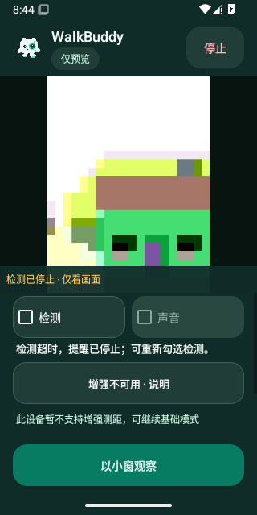
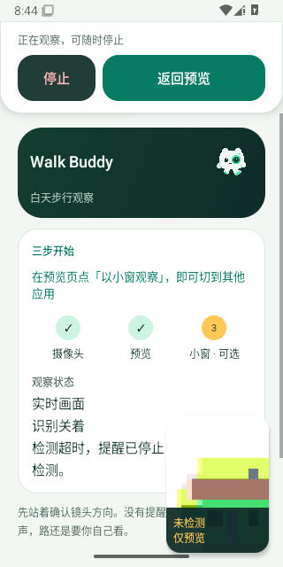

# v0.4.19 检测故障后的原生界面

截图来自候选源码 `9c1dc12f0259db7d42811c7ffbd7fe76255a1a35` 的 [41027940942](https://github.com/cyanrbt/walkbuddy/actions/runs/41027940942)，API 35 artifact `12964363828`；ZIP SHA-256 `02e484b1979fa0f64136184c49d7841265f2e917c6b9442781fe2b16229f2018` 已与实际下载核对。原图未编辑。

画面是 Android 模拟器的虚拟 Camera2 场景；检测超时由测试 worker 阻塞并注入过期分析心跳触发，不是实际识别了图中的对象，也不是实体设备测试。用例检查相机和纹理身份保留、采集/显示时间继续推进、检测与声音关闭、旧反馈清除，释放阻塞后的结果被丢弃。

| 完整预览 | 实际系统小窗 |
| --- | --- |
|  |  |

小窗截图在根视图宽高均小于完整界面、缩窗后真实相机心跳继续推进后采集。首页的“停止 / 返回预览”仍位于顶部，小窗持续显示“未检测 / 仅预览”。这些截图验证此候选的基础预览故障场景；最终候选另增加了增强/姿态状态与故障小窗并存的布局检查，尚待云端完成，不能用本页替代 AR、TalkBack 或 Find X8 Ultra 验收。
