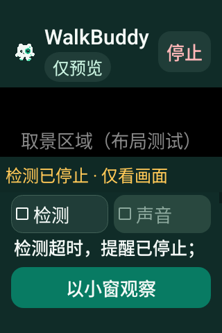

# v0.4.19 检测故障后的原生界面

截图来自最终候选源码 `9d9880511273f66f9e36b879a46bd52bf39c4df9` 的 [41031071106](https://github.com/cyanrbt/walkbuddy/actions/runs/41031071106)，API 35 artifact `12964809925`；ZIP SHA-256 `167272ae9fe63e75379b4d4b0453f7230fc64706530ab17f6656186b061b5de6` 已与实际下载核对。原图未编辑。

画面是 Android 模拟器的虚拟 Camera2 场景；检测超时由测试 worker 阻塞并注入过期分析心跳触发，不是实际识别了图中的对象，也不是实体设备测试。用例检查相机和纹理身份保留、采集/显示时间继续推进、检测与声音关闭、旧反馈清除，释放阻塞后的结果被丢弃。

| 完整预览 | 实际系统小窗 |
| --- | --- |
|  |  |

小窗截图在根视图宽高均小于完整界面、缩窗后真实相机心跳继续推进后采集。首页的“停止 / 返回预览”仍位于顶部，小窗持续显示“未检测 / 仅预览”。增强/姿态状态与故障小窗并存的组合布局检查已通过，两套 API 各完成 60 组故障提示呈现。AR、TalkBack 和 Find X8 Ultra 实机仍待验收。

下图仅为 320×480、200% 字体、夜间模式的构造布局，未启动相机；检查故障提示和检测开关在初始视口可见，完整详情可继续滚动。

