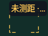
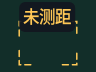
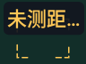
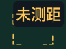
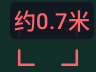
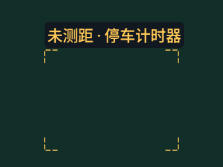
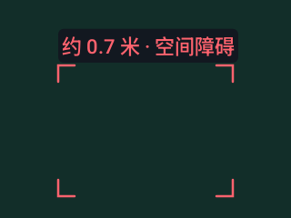

# v0.4.22 原生标签截图复核

API 36、densityDpi 160 的 Canvas 构造标签样例，原始像素直接取自 Actions 附件；没有真实相机物体或深度识别。矩阵另在 API 35 复核。图像宽度以像素保存，恰好对应本次测试的 dp。

首个候选 `cd4e1b6` / [41048695368](https://github.com/cyanrbt/walkbuddy/actions/runs/41048695368) 的布局与对比度通过，但肉眼复核发现窄窗中出现没有对象字符的分隔符/省略号。最终 `a6d5f91` / [41051697662](https://github.com/cyanrbt/walkbuddy/actions/runs/41051697662) 将这种情况收为完整限定。字号、颜色和轮廓语义不变。

| 96dp 宽度 | 初始候选 | 最终候选 |
| --- | --- | --- |
| 150% 字号 |  |  |
| 200% 字号 |  |  |

200% 字号、96dp 测距标签：

200% 字号、320dp 宽度下保留完整对象名称：

每套原生矩阵 1530 组布局、18 组实际亮暗底色对比度通过；最小对比度 API 35 为 5.0551，API 36 为 5.0423。[结构化记录](../../profiles/overlay-fonts-native-2026-10-30.json)含来源提交、artifact 摘要和实际标签。单标签边界检查不能证明密集多目标无重叠，真实设备字体、TalkBack 和空间检测仍需验收。
