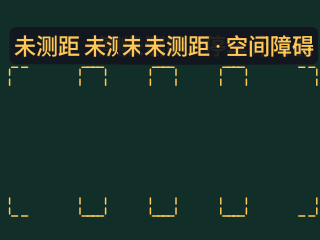
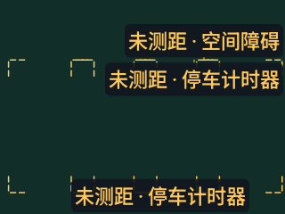
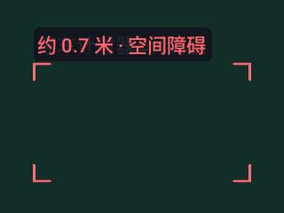
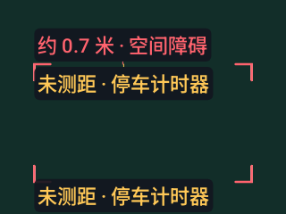
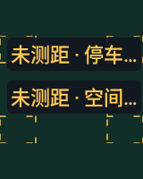

# v0.4.23 密集标签原生对照

API 36、densityDpi 160、200% 字号的真实 Canvas 输出，原始 PNG 直接来自已下载 Actions 附件。场景使用构造 Detection，不是真实物体/深度识别。基线 `d20d74f` / [41054551654](https://github.com/cyanrbt/walkbuddy/actions/runs/41054551654) 的主应用与 v0.4.22 相同；修正为 `7715207` / [41055342617](https://github.com/cyanrbt/walkbuddy/actions/runs/41055342617)。

| 320dp 场景 | v0.4.22 行为 | v0.4.23 候选 |
| --- | --- | --- |
| 四个同排目标 |  |  |
| 31 个同处目标 |  |  |

96dp 小窗只保留能容纳的高优先距离，不缩小字号：

160dp 留黑边四角场景，标签不进入留黑边：

后绘全图灰色蒙版时，标签仍最后绘制；三档字号的标签区域逐像素换序对照一致：

两套 API 各 36 个构造场景，基线合计 4509 对矩形相交，修正为零，另验证 2dp 间距、完整限定、近风险优先、换序稳定与缓存复用。这里的减少包含省略部分标签，不是所有目标名称同时出现；检测输出、轮廓和提醒保留。原始字段与摘要见[排版记录](../../profiles/overlay-crowd-2026-10-30.md)。实体设备、真实密集目标对应关系及运动中的跳变仍待验收。
