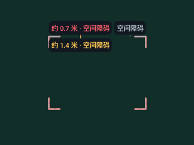
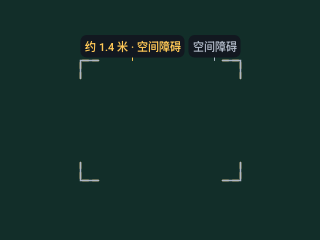
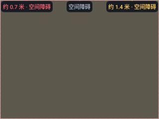
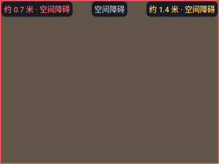

# v0.4.24 风险层级原生对照

以下为 API 36 / densityDpi 160 / 100% 字号的原始 Canvas PNG，含正常标签。使用构造 Detection，不是真实物体/深度识别或运动追踪。基线 `9a29432` / [41059529348](https://github.com/cyanrbt/walkbuddy/actions/runs/41059529348) 的主应用与 v0.4.23 相同；修正为 `fc684e0` / [41059784053](https://github.com/cyanrbt/walkbuddy/actions/runs/41059784053)。

| 相同目标、低风险最后输入 | v0.4.23 行为 | v0.4.24 候选 |
| --- | --- | --- |
| 红色近障碍与黄/灰框重叠 |  |  |
| 黄色关注与灰框重叠 |  |  |
| 三风险全图填充 |  |  |

独立读取 PNG 的采样像素，与原生 JSON 一致；采样点经 View 排版字段确认不在文字背景内。API 36 的示例 ARGB：

| 场景 / 输入顺序（0灰、1黄、2红） | 采样点 | 基线 | 修正及参考值 |
| --- | --- | --- | --- |
| 近障碍轮廓 / 210 | (80,175) | `ffaeb7c5` | `ffff636e` |
| 黄色轮廓 / 10 | (80,175) | `ffaeb7c5` | `ffffc857` |
| 全图填充 / 210 | (160,120) | `ff5c584b` | `ff605548` |

两套 API 各 14 组构造顺序，基线各 10 组与参考不一致，修正各为 0；修正后每类场景的全部顺序图片逐像素一致。填充参考由各自平台的独立 1px Canvas 计算，不要求不同 Android 版本的混色像素完全一致。原始字段、服务端归档摘要与范围见[记录](../../profiles/risk-paint-2026-10-30.md)。

文字仍在形状之后，可能遮住部分边线；本项不保证整条轮廓永远无遮挡，也不代表跨帧标签跟随或实体设备验收已完成。
