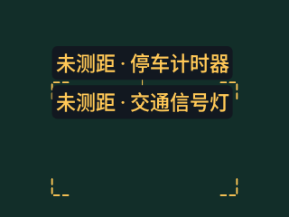
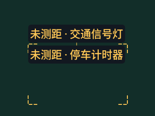
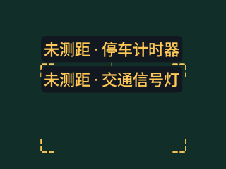
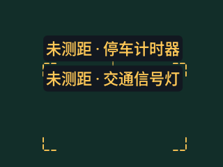

# v0.4.25 标签位置偏好对照

API 36 / densityDpi 160 / 200% 字号的原始 Canvas PNG。两个构造目标每帧缓慢水平移动，.79/.81 分数与输入顺序交替；不是真实识别或目标身份追踪。基线 `be786f7` / [41065235226](https://github.com/cyanrbt/walkbuddy/actions/runs/41065235226) 的应用与 v0.4.24 相同，修正为 `83b8106` / [41067870083](https://github.com/cyanrbt/walkbuddy/actions/runs/41067870083)。

| 320dp | v0.4.24 行为 | v0.4.25 候选 |
| --- | --- | --- |
| 帧 0：停车计时器分数较高 |  |  |
| 帧 1：交通信号灯分数较高 |  |  |

帧 7 的框与标签继续向右移动，沿用的是边缘位置偏好，不是旧坐标：

160dp / 200% 仍保持完整「未测距」，名称按原规则省略：

三档字号、160/320dp 共六组八帧序列；两套 API 各 48 帧，基线各 84 次超过 8dp 的垂直换位，修正各为 0。目标垂直坐标恒定，此处只统计该构造场景中的垂直换位，不推断真实运动频率、水平抖动或遮挡交叉能力。坐标和服务端摘要见[完整记录](../../profiles/label-continuity-2026-10-30.md)。

匹配有歧义、风险/测距/形状类型变化、状态过期或重置时允许重新排版；风险优先、当前框/文字和原提醒规则保持。实体设备、真实运动、OEM 字体和 TalkBack 仍待验收。
