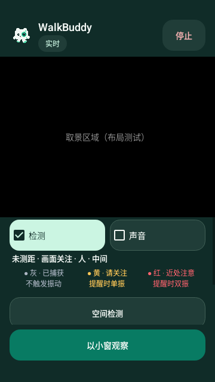
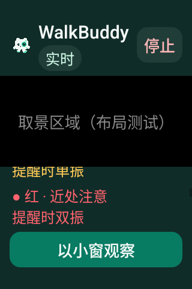
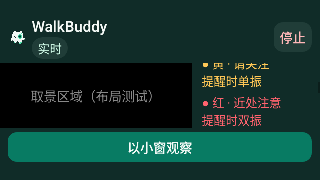

# v0.4.27 分级触觉图例

Android 16 / API 36 / densityDpi 160 原始软件 Canvas PNG，来自发布标签 `7cd5dfcfed9ad78d076f4c3cd9a34d281e920cc0` 的 [41083803493](https://github.com/cyanrbt/walkbuddy/actions/runs/41083803493)。画面明确标注“布局测试”，标题与基础关注内容是构造样式，不是真实相机、真实识别或 AR 效果。

普通字号的三列图例紧接当前详情，显示灰不触发、黄提醒时单振、红提醒时双振：

200% 字号时改为纵向列表。下图为小屏滚动到红色图例之后，前面的开关和其它图例可通过滚动读取；保留用户字号及固定主要操作，不保证长面板内容同时出现在初始视口：

横屏仍保持取景和侧栏，下面为 200% 夜间样式的滚动位置：

三张图从 API 36 artifact `12991136824` 原样提取，ZIP 10,113,781 字节，SHA-256 `999965b38f0bca328d462fdb0d25aed6f5f437986ae8edb57630ba97594ed7c2`，与服务端一致。该附件九项 PASS、30 组图例/缩放、系统效果构造及两轮 Activity 记录输出检查通过；[结构化记录](../../profiles/haptics-native-release-2026-10-30.json)保留来源和范围。

系统效果构造、记录输出和静态图不证明实际振感或 TalkBack 可用性；实体设备、真实运动与厂商策略仍待验收。
