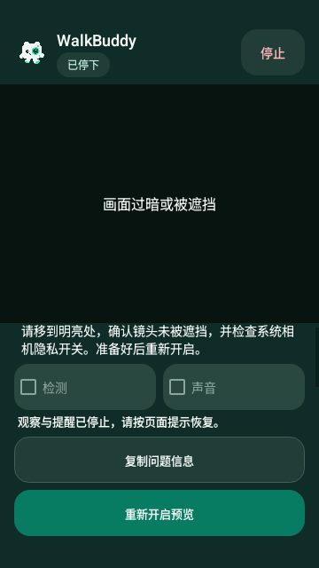
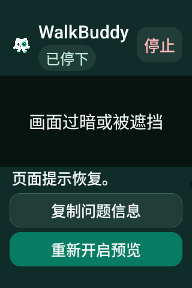

# v0.4.28 复制问题信息入口

Android 15 / API 35、densityDpi 160 原始软件 Canvas PNG，来自源码 `f1b32c951e8217b495b4d38662818527e455b544` 的 [41091065722 attempt 1](https://github.com/cyanrbt/walkbuddy/actions/runs/41091065722/attempts/1)。这是实际布局的构造过暗恢复场景，不是真实镜头故障或识别画面。

普通字号下复制入口在故障说明后，重新开启保持底部主要操作：

200% 字号的小屏滚动到复制入口，前面的说明和开关可以向上滚动读取；底部重新开启保持可见：

两图从 API 35 artifact `12993838318` 原样提取，ZIP 9,907,062 字节，SHA-256 `0c13c9bcd62e5a16227fa0af1968d3793103c3aaf5e42850d0a7cc88ece2f4e6`，已与 GitHub 匹配并实际查看。该 API 十项通过；同轮 API 36 首项恢复失败，未把局部通过称为整轮通过，[初轮原始记录](../../profiles/diagnostics-native-initial-2026-10-31.json)保留区别。

截图验证文字和滚动可达；真实剪贴板、页面重建和虚拟 Camera2 另由支持探针验证。实体设备和 TalkBack 仍待验收。
