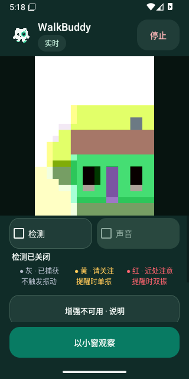
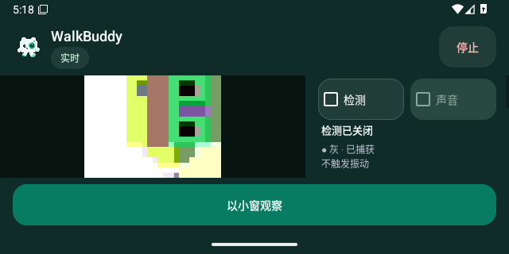

# v0.4.29 实际旋转后的相机区域

两张原始系统截图来自 Android 16 / API 36，源码 `996c9f0d91bf3ae7e6625a09c1983e5db35ec4bd` 的 [41096792807](https://github.com/cyanrbt/walkbuddy/actions/runs/41096792807) attempt 1。截图为真实 Activity 与虚拟 Camera2 图案，不是真实道路或 AR；它们展示布局与黑边，不记录转场动画帧率，也不验收真实手机的世界方向。

竖屏恢复后，实际图像宽 202px、高 269px，两侧黑边不再包括在动画矩形里：

真实 Activity 转到横屏后，动画矩形随相机内容更新，控制区在右侧，相机与纹理实例保持：

两图从 API 36 artifact `12997181573` 原样提取，ZIP 9,927,089 字节，SHA-256 `85ed8e17585ef83084da4cc7f2af21a6992dc9244cee822cd1f9b10240996774`；已完整下载、匹配服务端摘要并实际查看。[候选原始记录](../../profiles/pip-source-native-candidate-2026-10-31.json)保存两套系统的完整十项结果、真实矩形和故障报告。

两套首次通过，每套两轮旋转/恢复各三组和小窗/展开各两组核对。API 35 日志另有系统服务 ANR 观察，保留事实且不推断为本应用问题原因；实体动画、真实镜头、TalkBack 与性能仍待验收。
