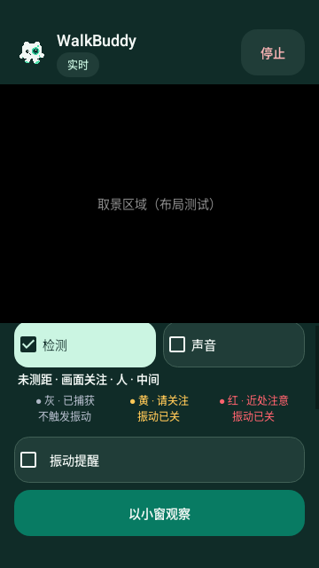
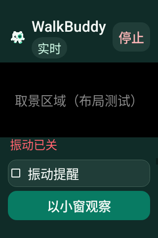

# v0.4.30 振动提醒独立开关

Android 16 / API 36、densityDpi 160 的原始软件 Canvas PNG，来自源码 `5880150b5fce5a976e5ce950bde4903e094d6faf` 的 [41101431137](https://github.com/cyanrbt/walkbuddy/actions/runs/41101431137) attempt 1。画面明确标有“布局测试”，检测开启与风险文本是构造状态，未打开相机或执行真实风险检测。

普通字号滚动到振动设置：视觉检测保持开启，振动 checkbox 未勾选，黄/红图例同时显示“振动已关”，主要小窗操作固定在底部：

小屏 200% 字号滚动到振动设置：上一条红色图例的末行仍可见，前面的开关和完整图例可向上滚动读取，振动 checkbox 和固定主要操作完整可见：

两图从 API 36 artifact `12999716512` 原样提取，ZIP 11,021,895 字节，SHA-256 `3a4ec0b7cf44e24d8a5e3fbe395a31edac1991fcbf0ad34e7689c9d2bfb17b9e`，已匹配 GitHub 并实际查看。[候选原始记录](../../profiles/vibration-choice-native-candidate-2026-10-31.json)保存两套十项结果、受控关闭报告与原生检查范围。

布局截图不证明实体振感或 TalkBack 朗读，实际马达、音频、厂商系统与真实 AR 仍待验收。
