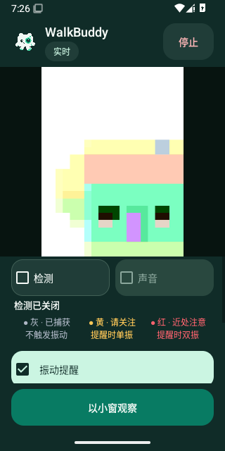
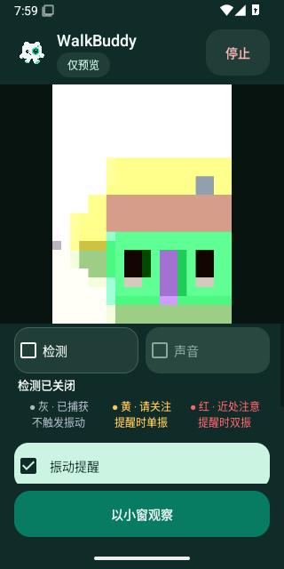
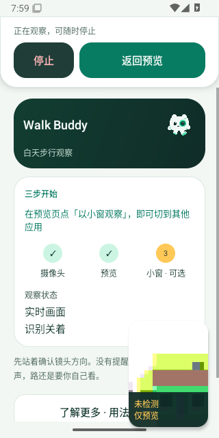
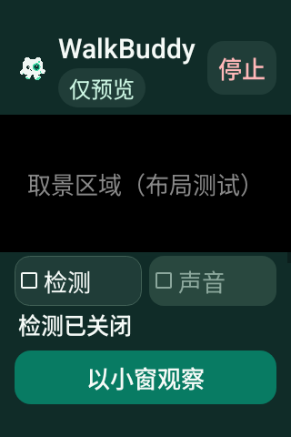

# 默认仅预览状态

下方普通手机图来自 Android 15 虚拟 Camera2 的真实 Activity，检测与声音均关闭。前版「实时」说明画面新鲜，新版「仅预览」同时明确当前没有开启检测；相机和模型没有因此自动开关。

| v0.4.32 | v0.4.33 |
| --- | --- |
|  |  |

## 实际系统小窗

根视图从 320×640 缩至 116×155，取得新的采集/显示帧后原样截屏。整张 PNG 仍为屏幕尺寸，小窗位于右下角；背景首页显示「识别关着」，小窗保留「未检测 / 仅预览」。

## 大字体

下图是 320×480、200% 字号的原生布局样例，灰色取景占位文字属于测试夹具，没有打开真实相机或产生检测结果。

[首轮截图](initial-mode-callback.png)没有证明缩小后的窗口尺寸，仅作为采证范围补充保留。修订候选加入真实尺寸与新帧条件后取得上方系统小窗图；不是生产功能修复重跑。[来源与摘要](source.json)对应完整原始附件，[验证记录](../../profiles/preview-only-default-2026-10-31.md)保留首轮、修订候选、外部系统 ANR 和实体设备边界。图片未裁切或重绘。
