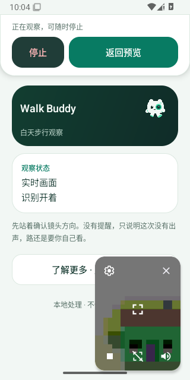
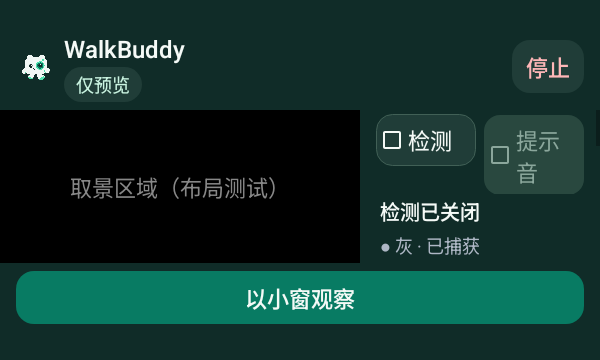
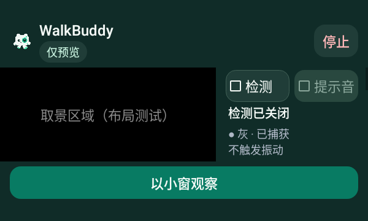
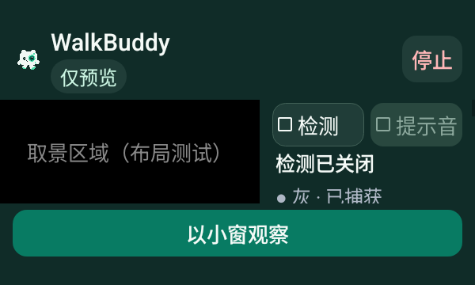

# 小窗提示音与大字体横屏

下方小窗图来自正式 v0.4.35 标签的 Android 15 虚拟 Camera2 真实窗口，系统菜单中最右侧是提示音动作；左侧两个动作继续停止相机、关闭检测。测试通过实际屏幕触摸切换开关，没有生成或重绘截图。声音输出为受控 worker，不代表实体设备听感。

| 提示音关闭，菜单提供打开动作 | 提示音开启，菜单提供关闭动作 |
| --- | --- |
|  |  |

## 横屏与系统字号

以下为原生布局夹具，黑色区域标有「取景区域（布局测试）」，没有打开相机。对照同为 600×360、150% 字号和检测关闭状态；侧栏按文字需要增宽，「提示音」保持一行，原字号保留。

| 首轮标签换行 | 修正后完整标签 |
| --- | --- |
|  |  |

[来源与 SHA-256](source.json)绑定完整原始附件和源码；[验证记录](../../profiles/pip-sound-controls-2026-10-31.md)区分初轮失败、修订候选、正式标签与设备范围。系统菜单布局及容量随设备变化，真实设备可读性和 TalkBack 朗读仍待验收。

修订候选的[关闭](menu-sound-off.png)/[开启](menu-sound-on.png)菜单及 [150%](landscape-font150.png)/[200%](landscape-font200.png) 横屏原图一并保留。正式标签对应相同生产/测试源码，最终 APK 已实际下载核对版本、固定签名与摘要。
