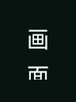
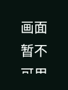

# v0.4.36 恢复界面

原样 Android PNG，未重绘。基线是 v0.4.35 生产布局的静态原生取样，没有打开相机；候选与正式标签图在取得原始附件后补充。[完整来源与验证](../../profiles/recovery-presentation-2026-10-31.md)。

96×128 / 200% 字号的旧停止提示实际裁切：

116×154 / 150% 字号也存在裁切：

