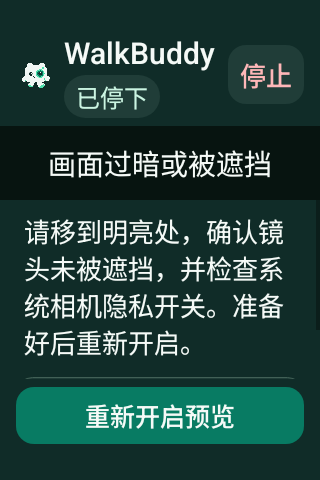
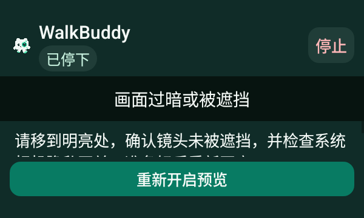
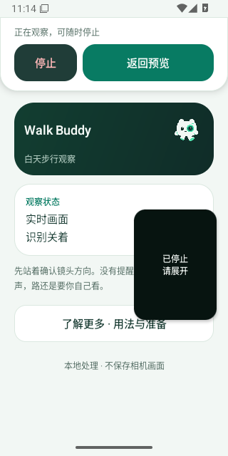
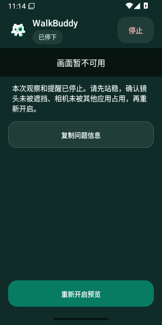

# v0.4.36 恢复界面

原样 Android PNG，未重绘。基线是 v0.4.35 生产布局的静态原生取样，没有打开相机；候选图如下，正式标签图在取得原始附件后补充。[完整来源与验证](../../profiles/recovery-presentation-2026-10-31.md)。

96×128 / 200% 字号的旧停止提示实际裁切：

116×154 / 150% 字号也存在裁切：

## 已验收候选原图

[候选 41141509019](https://github.com/cyanrbt/walkbuddy/actions/runs/41141509019)，API 36；完整摘要、来源及逐图摘要见 [source.json](source.json)。静态恢复视图没有打开相机，实际系统小窗来自虚拟 Camera2 过期停止之后；不代表实体设备。

200% 字号的最小小窗、竖屏说明与横屏滚动说明：

真实系统停止小窗及展开后的完整恢复界面：

此候选图截在首页重绘前：小窗已停止，首页像素仍为前一帧，不能用作首页最终状态证明。原生视图状态/报告已按严格断言更新；正式采证在此停止状态截图前增加 150ms 非主线程等待，不改生产代码或断言，正式原图另列。

