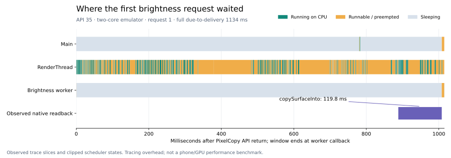

# 首次亮度请求的渲染等待

## 来源与范围

来源为源码 `1b5217706b5a0fd0d7ee755ed7cb6d0cd7eaeff3` 的 [API 35 系统轨迹作业](https://github.com/cyanrbt/walkbuddy/actions/runs/41178081292/job/124469681763)第一条轨迹。完整附件 `13034166185` 为 78,270,871 字节，SHA-256 `89907da4370c45a0ea2be825a2d3e09755a5e54f7673378dc265dce3ea3a002e`；原始轨迹为 98,990,142 字节，SHA-256 `c05660c8b13006979e83f1839f6091f4d552fe8d0daa12435c2187ed3b514cb3`。本轮重新确认保留的附件字节一致，提取原始轨迹并验证长度、摘要与条目 CRC，用此前固定的官方 v59.1 引擎执行本页 SQL。上一轮[完整原始核验](surface-startup-fixed-native-2026-10-31.json)保留。

目标是进程 `3638`、请求 `1`，从最早到期帧至交付为 1134ms。下面使用同一条轨迹的 `RETURN` 与 `CALLBACK` 日志时间界定 1015.013316ms 窗口，所有 CPU、状态和区段均与窗口求交，避免把窗口外工作算入其中。阶段消息自身的纳秒差为 1015.004950ms，两者相差约 0.008ms，来自日志写入时点；不是重复或混用不同录制样本。

## 实际观察



图中只有绿色是实际占用 CPU，橙色为可运行但未被调度，灰色为休眠；紫色单独标记观察到的原生区段，不是 GPU 利用率。[逐纳秒核对摘要](brightness-wait-summary-2026-10-31.json)确认三个线程的状态覆盖与窗口长度一致，`Running` 总和与实际 `sched` CPU 时间一致。

| 线程 | 实际 CPU | Runnable（含抢占） | Sleeping |
| --- | ---: | ---: | ---: |
| 主线程 | 1.988ms | 7.926ms | 1005.099ms |
| RenderThread | 291.231ms | 723.758ms | 0.025ms |
| 亮度线程 | 0.132ms | 7.164ms | 1007.717ms |

`R`/`R+` 表示可运行/被抢占后可运行，`S` 表示休眠；可运行不是正在使用 CPU。解释依据为 [Perfetto 调度文档](https://perfetto.dev/docs/data-sources/cpu-scheduling#decoding-end_state)。亮度线程主要等待，主线程两段 `postAndWait` 与 RenderThread 活动重叠；不是亮度线程持续进行像素求和。

同进程中观察到的 `copySurfaceInto` 在 API 返回后约 888ms 开始，持续约 120ms，回调随后到达。其关联依据为同进程、单个在途亮度请求及相邻时序，不宣称具有原生跨线程请求 ID。不能把整段 1015ms 等待当作纯像素复制或纯 GPU 耗时。RenderThread 还存在绘制、shader 编译及图形模拟器命令编码区段。

窗口内实际调度 CPU 仅 0、1；两个核均完整覆盖 1015.013316ms，未观察到 idle 或未归属线程片段。同期应用 CPU 合计约 490.7ms，其中 RenderThread 291.2ms、JIT 187.5ms；相机服务、SurfaceFlinger 和虚拟图形合成服务还分别使用约 346.2/262.4/260.6ms。跨核合计 CPU 可大于墙钟。这支持该窗口存在调度拥塞，不能据此断言实际手机 GPU 性能，或解释另一轮真正失败的 1436/1420ms 画面过期。

原作业日志明确输出 `cores: 2`，AVD 配置为 `hw.cpu.ncore=2`。固定版 [emulator-runner 配置](https://github.com/ReactiveCircus/android-emulator-runner/blob/a421e43855164a8197daf9d8d40fe71c6996bb0d/action.yml)默认也是两核。[GitHub 当前公开运行机规格](https://docs.github.com/en/actions/reference/runners/github-hosted-runners)列出公开仓库 Ubuntu 的四个 vCPU，但这不是原运行机容量的实测证据，不能据此直接声称原机闲置了两个核。

## CPU 容量实验

保留普通 UI、原系统轨迹和发布检查默认请求两核。新增 `CPU capacity trace` 请求最多四核，仍执行相同的三条轨迹、完整相机/像素前序与十项普通检查。新共用步骤实际记录运行机亲和性、可读的 cgroup CPU 配额与最终配置数，按可用容量限制；模拟器启动后读取在线 CPU，实际数目不一致时失败并保存原始数值。

这是单独的资源配置实验，不提高应用启动、画面或模型截止，不改变应用源码或 v0.4.38 安装包。不同运行机及不同采证开销不构成配对设备性能比较。两核原始拥塞样本与历史失败继续保留；不能只选较快配置来宣称应用停顿已修复。

本地 57 项工具测试通过，8.266 秒；覆盖 CPU 配额限制、保持两核请求、实际两核不得标记成四核、异常 CPU 列表和实体设备保护。四个工作流的 actionlint、共享 shell 语法及差异检查通过。新增云端实验结果待推送后取得。

## 重放

将原附件中的 `preview-trace/trial-1/trace.pftrace` 提取到临时目录并核对上述摘要，执行两份只读 SQL：

```sh
trace_processor_shell query --format csv --no-progress -f docs/profiles/brightness-wait-stages-2026-10-31.sql /tmp/trial-1.pftrace
trace_processor_shell query --format csv --no-progress -f docs/profiles/brightness-wait-cpus-2026-10-31.sql /tmp/trial-1.pftrace
```

[线程与区段原始查询结果](brightness-wait-stages-2026-10-31.csv)、[逐核结果](brightness-wait-cpus-2026-10-31.csv)保留，不将同一线程的嵌套区段累加为互斥工作时间。查询只适用于本页明确标识的原始样本。

`python3 docs/profiles/plot-brightness-wait-2026-10-31.py` 可从两份 CSV 重建摘要与 SVG，本轮使用 Matplotlib 3.11.0。绘图脚本先断言状态/CPU 时间覆盖、双核完整窗口和唯一相关复制区段，再生成图表；原始轨迹、APK 和临时 PNG 不提交仓库。
