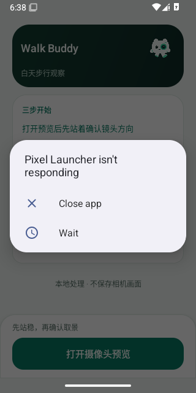

# 2026-10-30 首次触摸超时的系统 ANR 证据

重新检查 [41014998568 attempt 1](https://github.com/cyanrbt/walkbuddy/actions/runs/41014998568/attempts/1) 的 API 35 job `123929214335`，实际下载 artifact `12959501925`：45,827 字节，ZIP SHA-256 `17ee1745505c5a23044ca3eef7807b12e5558687df3721ecbb0a8a7003780d4b`。此前只根据日志记为“首次触摸准备超时，原因未定”；这次核对了原始失败截图和完整生命周期日志，得到更具体的证据。

## 这一次已确认的直接阻挡

原始 `pip-recovery-failure.png` 显示应用首页上方有 **Pixel Launcher isn't responding** 系统弹窗，应用被遮挡。截图已原样保存，未编辑：



同一附件的关键日志：

```text
10-30 06:38:19.415 559 2188 E ActivityManager: ANR in com.google.android.apps.nexuslauncher (com.google.android.apps.nexuslauncher/.NexusLauncherActivity)
10-30 06:38:19.415 559 2188 E ActivityManager: Reason: Input dispatching timed out (Application does not have a focused window).
10-30 06:38:28.751 559 1654 I ActivityTaskManager: START u0 {flg=0x10000000 cmp=com.cyanrbt.walkbuddy/.MainActivity} ...
10-30 06:38:32.254 559 579 I ActivityTaskManager: Displayed com.cyanrbt.walkbuddy/.MainActivity for user 0: +3s717ms
PIP_RECOVERY_PROBE_FAIL: java.lang.AssertionError: Timed out: touch target ready id=2130903111; interactive=true keyguard=false; 已停止；请主动开启
```

Launcher ANR 发生在 WalkBuddy 首页启动前约九秒；该次尚未打开相机或初始化模型，`pip-timing.txt` 为空，应用 crash 日志为空。结合失败当时截图，可确认系统 ANR 弹窗遮挡首页，是这一次首次触摸无法就绪的直接阻挡。Launcher 自身为什么 ANR 尚未定位，不能把云端环境的一个失败外推到实体手机。

## 其它失败仍需分别定位

另复核 v0.4.18 首轮 API 36（artifact `12957355801`）和此前 API 35 触摸恢复附件：两者生命周期日志也出现 `com.google.android.as` 的 ANR，但截图没有显示该弹窗。这里仅证明与 Android System Intelligence ANR 同时出现过，**未证明是锁屏后目标 UID 注入错误或 PiP 恢复失败的原因**。原有[锁屏输入摘录](input-after-wake-2026-10-30-v0.4.18.md)保留；重跑通过仍不当作问题修复。

Android 官方说明 [ANR 弹窗](https://developer.android.com/topic/performance/issues/anr)，AOSP [AppNotRespondingDialog](https://github.com/aosp-mirror/platform_frameworks_base/blob/android-15.0.0_r1/services/core/java/com/android/server/am/AppNotRespondingDialog.java) 的窗口标题使用 `Application Not Responding: <processName>`。该标题可用于今后的失败时焦点快照核对；仅出现历史 ANR 日志不足以证明输入焦点被抢占。

## 本轮诊断改动

- 触摸准备超时或输入注入异常时，保留原始异常和目标名称、Activity、焦点、附着/可见/启用状态、有效范围及各级祖先的布局状态。触摸准备谓词、十秒等待、真实 `sendPointerSync`、采集/分析截止均未放宽。
- 在 PiP 探针失败后、Activity 和 instrumentation 清理前，保存原始截图以及 `dumpsys window windows`、`input`、`activity activities`，避免清理后焦点已改变。每份文本最多 4MiB，每次 dumpsys 服务请求使用三秒超时；采集失败不替代原始故障。命令与超时参数依据 [dumpsys 官方接口](https://developer.android.com/tools/dumpsys)。
- Actions 摘要分列模拟器测试 APK 编译与模拟器运行结果，再列九份标准探针记录和 ANR 包名。只有失败时焦点明确指向外部 ANR 窗口时，才写“外部 ANR 弹窗占有输入焦点”；单独的后台 ANR 只记观察事实。摘要不自动关闭弹窗、不改失败为成功；线程/调度诊断也不冒称跑过九项标准探针。
- 八项宿主测试覆盖完整通过、缺记录、失败与通过标记共存、编译失败、外部 ANR 同时出现、明确焦点阻挡、应用自身 ANR 和诊断模式；已用实际旧附件重放，旧附件没有焦点文本时，摘要只给出 ANR 观察，不自动推断原因。

生产源码、模型、依赖、包名、签名及 0.4.18 / 30 版本均不变。本轮修改测试包和 CI 诊断；八项宿主测试、工作流静态检查与本地 Android 测试包构建通过，没有实体设备验收结论。

## 云端结果与尚未覆盖的分支

提交 `a408b0d4c1a3520916b4714c568bf9cabaa9009d` 的 [41022973332](https://github.com/cyanrbt/walkbuddy/actions/runs/41022973332) attempt 1 成功。API 35 job `123954381437`、API 36 job `123954380937` 均首次通过，含八项报告测试、测试包编译、九项标准探针与摘要生成。已实际下载两套附件并核对摘要与原始探针记录；按相同原始文字在本地重放报告器，结果与云端 JSON 完全一致。

| API | 实际 artifact | ZIP SHA-256 | 已保存报告 |
| --- | --- | --- | --- |
| 35 | 12963055494 / 7,512,966 字节 | `508a4a1a157a89d1216a10d40098c9c62e0bd3797209cf2d23cf7b578b71eadb` | [api35-ci.json](input-2026-10-30-api35-ci.json) |
| 36 | 12962347407 / 7,556,285 字节 | `1ba35860acfb57ee7bc1f55a144801477c98f472bfbfd50498b8d336bebe19d1` | [api36-ci.json](input-2026-10-30-api36-ci.json) |

两套各九项原始通过记录齐全，已收集的 ActivityManager 日志没有 ANR 条目。**本轮未发生输入失败，因此没有实际触发新的失败时 dumpsys 采集分支**；该分支当前通过编译核验，尚待真实失败运行检验。窗口标题分类由宿主测试和 AOSP 标题契约覆盖，不冒称已完成云端阻挡弹窗复现。一次首次成功不证明 Launcher ANR、其它锁屏输入故障或模型冷启动问题已消失。
