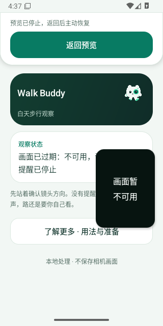

# v0.4.28 首轮小窗显示截止

源码 `f1b32c951e8217b495b4d38662818527e455b544` 的 [41091065722 attempt 1](https://github.com/cyanrbt/walkbuddy/actions/runs/41091065722/attempts/1)，API 35 job `124184760730` 十项全过；API 36 job `124184760241` 的首项 `pip_recovery` 失败，其余九项通过，整轮失败。应用和测试包编译成功，尚未创建发布标签。

两个原始附件已完整下载并匹配 GitHub 文件大小与 SHA-256，[初轮结构化记录](diagnostics-native-initial-2026-10-31.json)保留全部十项状态及复制/模型故障报告。API 36 artifact `12993444598`，9,870,143 字节，SHA-256 `68c447575bf897b80f9142b975a6d72527bb3b7893c991b030abc4648737cd0e`。

## 实际失败

这是第二次重新进入小窗后的显示帧超期，和此前触摸 UID 错误不同。真实点击被接受，第一轮恢复通过；本轮恢复前及重新进入前均为 LIVE。UTC 原始日志：

| 时间 | 观察 |
| --- | --- |
| 16:37:11.150 | 展开后系统输入已就绪 |
| 16:37:11.223 / 11.270 | 应用收到恢复请求并重新启动相机 |
| 16:37:14.074 | 应用收到小窗请求；采集与显示龄均 65ms |
| 16:37:14.248 | 系统接受小窗请求 |
| 16:37:14.585 | onPause 时仍 LIVE；采集龄 35ms，显示龄 249ms |
| 16:37:15.688 | 未开检测，采集龄 440ms、显示龄 1352ms；按原 1200ms 显示截止停止预览 |
| 16:37:16.456 | 小窗模式回调到达，状态已 UNAVAILABLE |

同一日志里前两次 `captureGapMs=1201` 是探针故意注入的过期，不能与这次 `displayGapMs=1352` 的自然间隔混为一谈。截图中小窗明确显示“画面暂不可用”，没有把最后一帧继续作为实时画面展示。

系统日志同段出现预启动接收器、拨号器服务等进程启动和慢操作，16:37:16.434 才记录 Posting BOOT_COMPLETED。只能认定同时出现；没有证据证明这些活动导致显示间隔，也不能据此排除应用或模拟器图形路径问题。两套摘要无 ANR 观察，原始失败截图未见 ANR 弹窗。

## 后续处理

完整初轮结果和截图保留；不改生产相机/显示截止，不降低检查门槛。仅请求同一源码的失败 Android 16 作业重跑一次，API 35 首次成功结果保留。后续运行结果待完成后记录；即使通过，也不称显示停顿根因已修复，真实设备仍待验收。
