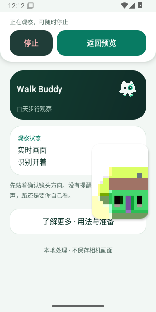

# 小窗停止命令归属

## 发现与参考

当前声音和关闭检测动作已携带归属信息，但 `StopPreviewReceiver` 对 `STOP_PREVIEW` 直接调用 `stopActivePreview()`，操作的是发送时的全局当前 Activity。旧停止 PendingIntent 没有 data 或 owner；从源码可推导，旧命令若在主动重开或新 Activity 启动后送达，会停止后来的观察。本轮先修正这个确定的路由缺口，不把它解释为先前的声音静音超时，也不声称已捕获用户设备上的同类自然故障。

参考 Android 开源的 [ApiDemos 画中画示例](https://android.googlesource.com/platform/development/+/master/samples/ApiDemos/src/com/example/android/apis/app/PictureInPicture.java)：自定义关闭由当前 Activity 的接收器调用自身 finish，停止时解除接收器。本项目据此采用“动作归属于发出它的观察”的约束，并额外覆盖同一 Activity 中的主动重开和多次小窗访问。参考时该文件 blob 为 `c1568e791ef3f61b18b0cb885098f153a3572890`。

[PendingIntent 官方说明](https://developer.android.com/reference/android/app/PendingIntent)指出，仅 extras 不参与操作身份匹配，UPDATE_CURRENT 会更新既有操作的 extras，IMMUTABLE 也不禁止创建方更新。因此本轮同时用 data URI 区分身份，避免旧对象通过 extras 更新变成新观察的有效按钮。

## 行为与实现

每次主动开启被接受后更新观察 owner；小窗尺寸、方向、声音选择、检测开关及进入/返回小窗不重新生成 owner。沿用当前 PiP 访问令牌，停止 PendingIntent 的 URI 和 extras 同时携带 owner 与 visit。接收器只允许当前观察、当前小窗访问、仍处于 PiP 的命令停止预览。

| 场景 | 结果 |
| --- | --- |
| 展开后送达旧小窗停止，或在完整页送达当前身份的停止 | 忽略，完整预览继续 |
| 同一次观察再次进入小窗后送达先前访问的停止 | 忽略，当前取景继续 |
| 主动重开后或创建新 Activity 后送达旧停止 | 忽略，新的相机与模型不受影响 |
| 无 owner/visit 的旧式停止命令 | 忽略 |
| 当前小窗停止，包括画面故障后的当前观察 | 释放资源并关闭预览 |

停止不依赖 LIVE、帧新鲜度或检测结果，也不使用会在故障时变化的 frame generation：故障后仍应能关闭当前小窗。首页和完整预览页的直接停止继续作用于用户当前看到的预览。权限、默认检测/声音选择、固定签名与模型保持。

## 验证安排

新增原生八场景，使用实际 Camera2、小窗进入/展开、真实 RemoteAction PendingIntent 发送与完成回调，记录实际送达的 owner、visit 和 data；旧动作送达后检查原相机、TextureView、亮度读回、模型 ticket 与 generation 保持，采集/显示继续前进。另在主线程临时仅改变 owner、用生产 stopAction 构造旧身份动作、立即恢复字段；要求 visit 相同而 PendingIntent 身份不同，并实际发送验证拒绝，以隔离 owner 校验及 data 身份。当前停止仍验证关闭 Activity；额外主动制造故障，再发送故障前当前菜单的停止，要求仍能关闭。每次运行独立保存 JSON；这里的 RemoteAction 发送不冒充用户在系统菜单上点击停止按钮。

本地 273 项 JVM、Lint、双 APK 编译通过（46 秒），补充 owner 独立校验后原生 APK 与 Lint 再次通过（31 秒），四个相关工作流 actionlint 通过。[源码和结果摘要](pip-stop-owner-local-2026-10-31.json)保留。八场景的实际 Android 运行待云端取得。候选为 v0.4.41 / 53，当前正式下载仍为 v0.4.40；正式标签与实际 APK 需要在候选通过后独立确认。没有实体设备、TalkBack、真实 AR、声音、帧率或功耗验收。既有小窗第二次静音超时与自然画面过期仍保持未定位，不据本修复宣称根因解决。

以上为本地阶段记录；随后结果如下。

## 候选原生结果与保留的菜单失败

源码 `c55eccda2b87152debebd91c68e14507b9d52a49` 首轮九作业中八个成功：[普通 UI](https://github.com/cyanrbt/walkbuddy/actions/runs/41199483406)、[四核专项](https://github.com/cyanrbt/walkbuddy/actions/runs/41199483116)、[三套像素专项](https://github.com/cyanrbt/walkbuddy/actions/runs/41199483112)均首次成功；[两核轨迹](https://github.com/cyanrbt/walkbuddy/actions/runs/41199483102)的 Android 16 成功，Android 15 后续声音菜单检查失败。九份原始作业日志均已读取，[首轮状态](pip-stop-owner-first-status-2026-10-31.json)保留，不将候选称为全部首次通过。

两套普通 UI 的完整附件为 17,786,991 / 17,825,191 字节，已核对服务端大小、SHA256、全部 ZIP CRC 并各重放十项报告。四次原生运行共 32 个停止归属场景通过，实际回调中的旧 owner/visit/data 与仍在前进的采集、显示逐条对应；故障前菜单停止在故障后仍可关闭，且仅 owner 不同的 PendingIntent 身份确实不同。[完整原生记录](pip-stop-owner-native-2026-10-31.json)保留。实际查看 Android 15 主动制造故障后的停止界面图；它是停止能力的受控故障，不是自然故障复现。

失败作业 `124532261583` 的 83,683,181 字节附件已完整核对服务端 SHA256 与 ZIP CRC，重放结果只有 `pip-repeat` 失败；三条原始轨迹的大小与 SHA256 逐条核对，云端各 complete、四次强制停止、零非强制超时，本轮未本地 SQL 重放。该作业第一轮停止八场景通过，第二轮只完成前五个停止场景，随后在声音菜单阶段失败，不能把未执行的后三项也称为通过。

新采证保存了清理前状态：LIVE、小窗仍在、声音勾选开启，采集/显示/模型龄为 51/18/178ms；应用提交的第三个动作是「关闭提示音」。当时只有三次按钮触摸及十二条命令记录，第四次目标按钮尚未找到，因此没有执行该次静音点击。系统菜单窗口未显示，小窗从原下方位置移到中部。该现场把本次失败限定在开菜单阶段，不能称为第四次声音命令被应用拒绝；小窗移动及菜单未出现的原因仍未定位，也不能解释旧的第二次静音确认超时。[完整失败状态与命令](pip-stop-owner-menu-failure-2026-10-31.json)及下图保留。

原失败保留后仅安排该作业一次同源码复验，结果另记；复验通过也不代表根因修复。正式发布继续使用两套普通 UI 门槛，并独立检查实际 APK。附件下载曾发生 HTTP/2 中断、连接器取数也短暂失败；同一文件续传或分段读取后核对完整 SHA，这些传输操作没有重跑应用检查，不与上述真实 UI 失败混称。
