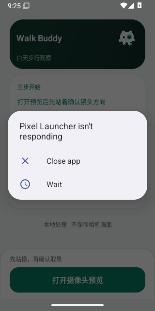

# v0.4.19 发布首轮系统 Launcher ANR

[Release APK 41033072437 attempt 1](https://github.com/cyanrbt/walkbuddy/actions/runs/41033072437/attempts/1)，标签固定为 `570b3b92b029f1098f34bc3301e49e50f9414c99`。API 36 job `123987227234` 首次通过；API 35 job `123987227595` 在首页首次触摸准备处失败，APK job `123989076206` 因依赖检查未通过而跳过。此轮尚未构建或发布 ARM64 APK。

已实际下载 API 35 artifact `12965913364`，66,197 字节；ZIP SHA-256 `4a8efee11a7fcd099de320ec15bca430946dbe1c597d677571f801dcf9a0ed57`。原始截图未编辑：



失败时 MainActivity 的按钮已附着、可见、启用、完成布局，focus=false；设备 interactive=true、keyguard=false。此时相机和检测尚未开启，不能归因于新检测故障用例或模型运行速度。

生命周期日志在 09:25:40.647 UTC 记录 `ANR in com.google.android.apps.nexuslauncher`，原因为缺少聚焦窗口导致输入派发超时。失败时 input 快照的第一组 FocusedApplications 为 WalkBuddy MainActivity，FocusedWindows 则明确为：

```text
displayId=0, name='5fb17b Application Not Responding: com.google.android.apps.nexuslauncher'
```

截图与输入快照共同确认该次系统 ANR 弹窗阻挡了首页输入。Launcher 自身为什么 ANR 未确定；没有自动关闭弹窗、改用 performClick 或放宽原触摸/帧/分析截止。

在首轮全部终态后，仅请求重跑失败的发布作业。重跑仍使用原标签和源码；attempt 2 最终成功，API 35 job `123990033526`、API 36 carried job `123990036749`、APK job `123991901447` 均成功。已实际下载发布 APK 并核验，见[附件记录](apk-v0.4.19.json)和[发布结果](../releases/v0.4.19.md#发布结果)。不能将重跑通过称为 Launcher 故障已修复。
